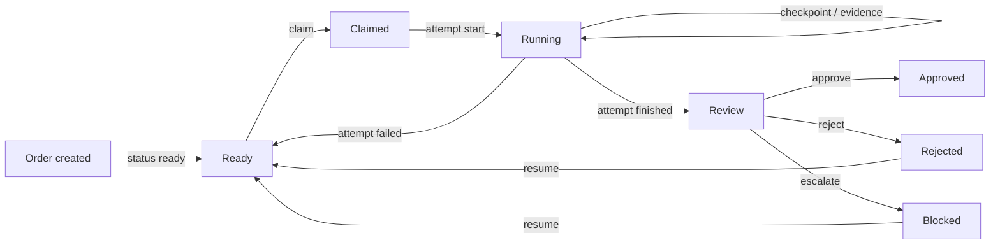

# Brayer

**Ink the work, not the transcript.**

<p align="center">
  <a href="https://github.com/igorjpimenta/brayer/actions/workflows/ci.yml"></a>
  <a href="https://www.npmjs.com/package/@igorjpimenta/brayer"></a>
  <a href="https://nodejs.org"></a>
  <a href="LICENSE"></a>
</p>

Brayer is a vendor-neutral work-order desk for coding agents. It records the work order, the attempts made against it, the handoff checkpoint, the content-addressed evidence, and the verdict — so a fleet of coding agents can be supervised by exception instead of by transcript. Every call carries the identity of the agent that made it, stamped at the connection layer so the model itself is never trusted to say who it is.

- **Work order in** — goal, acceptance criteria, workspace, budget, approval mode.
- **Handoff out** — a structured checkpoint pinned to the workspace tree hash, not a transcript.
- **Evidence attached** — diff, tests, screenshots, artifacts, all content-addressed by sha256.
- **Verdict recorded** — approve, reject, escalate or rollback, with an audit event.
- **Resume exact** — a leased attempt can die and continue in any harness without a re-brief.

It is local-first and vendor-neutral: OpenCode, OpenClaw and future harnesses are adapters, not the product. A work order is self-contained — no external planner task id is required. Stable releases publish since `2026.11.7` ([release notes](docs/releases.md)).

[Why the name?](#why-the-name) · [npm: @igorjpimenta/brayer](https://www.npmjs.com/package/@igorjpimenta/brayer)

## Install

Requires Node.js 22+.

```sh
npm install -g @igorjpimenta/brayer
brayer --version
```

The harness adapters publish separately and can use the same or different Brayer
versions than the daemon: [`@igorjpimenta/brayer-openclaw`](https://www.npmjs.com/package/@igorjpimenta/brayer-openclaw)
and [`@igorjpimenta/brayer-opencode`](https://www.npmjs.com/package/@igorjpimenta/brayer-opencode).
A `beta` dist-tag tracks prereleases (`YYYY.MM.DD-beta.N`) — see
[releases](docs/releases.md).

## Quick start

One daemon serves every harness. Start it:

```sh
BRAYER_MCP_BEARER=$(openssl rand -hex 32) \
  brayer serve --mcp http --port 38293
```

Point a harness at it and let the agent work an order — OpenClaw and OpenCode
configs are in [Harnesses](#harnesses). Inside the agent's session:

```
brayer_order_create  { title: "refactor invoice parser", goal: "…",
                       acceptance: "tests pass", status: "ready" }
brayer_order_claim   { orderId: "WO-…" }     # identity is stamped by the plugin
brayer_attempt_start { orderId }             # lease held, heartbeats keep it
… work …
brayer_evidence_attach / brayer_checkpoint_write
brayer_attempt_finish → review → brayer_verdict_issue
```

Verify from the operator side — no transcript reading:

```sh
$ brayer status
WO-lqcvx0si  refactor invoice parser   review   openclaw:main:agent:main:explicit:ses_x
```

All MCP tools and their contracts are defined in [`src/tools/`](src/tools/index.js) — or just list them from the running server.

## How it fits together

- The **Store** is one SQLite database (`~/.brayer/store.sqlite`) with content-addressed evidence blobs — the single source of truth, migrates applied on open.
- The **MCP server** exposes the whole desk as Brayer tools over stdio (one pipe per harness) or streamable HTTP (one shared daemon). Identity is stamped at the transport edge.
- The **Event stream** (`brayer serve --ws`) and claim webhooks notify dashboards and wake idle agents when work arrives.
- **Harness adapters** (`@igorjpimenta/brayer-openclaw`, `@igorjpimenta/brayer-opencode`) stamp identity, checkpoint on turn end (OpenClaw), and receive claim webhooks. The optional `brayer-wake` bridge prompts an OpenCode session when a webhook fires.

```
harness agent ──MCP (stdio | HTTP + X-Brayer-Harness)── ▶ MCP server ──▶ SQLite store
                                                            │  claim webhook / event stream
                                                            ▼
                                                      wake bridge → idle harness agent
```

## Identity

Every call is keyed `harness:agent:session`, and the harness is declared per **connection**, never by the model:

| Transport | Harness declared by | Example |
| --- | --- | --- |
| stdio | `BRAYER_HARNESS` env at launch | one pipe per harness |
| HTTP | `X-Brayer-Harness` header on the session's first request | one shared daemon, all harnesses |

The agent and session halves are stamped per call as a whole pair, in **one** channel: either `_meta.brayer` (`{ agent, session, harness }`) or flat `brayer_agent` / `brayer_session` arguments — halves never splice across channels. Mutating calls without a full pair refuse; the adapters do this stamping automatically. The harness name `any` is reserved and refused. See [lifecycle](docs/lifecycle.md) for the exact refusal contract.

## Harnesses

An adapter attaches an existing order; it never creates work.

**OpenClaw** — `@igorjpimenta/brayer-openclaw` stamps `_meta.brayer`, checkpoints on turn end, resumes from the latest checkpoint, and receives claim webhooks at `POST /api/brayer/claimed`.

```sh
openclaw plugins install npm:@igorjpimenta/brayer-openclaw@latest
```

One daemon for all harnesses (recommended):

```json
{
  "mcp": {
    "servers": {
      "brayer": {
        "url": "http://127.0.0.1:38293/mcp",
        "headers": {
          "X-Brayer-Harness": "openclaw",
          "Authorization": "Bearer <BRAYER_MCP_BEARER>"
        }
      }
    }
  }
}
```

One pipe per harness instead:

```json
{
  "mcp": {
    "servers": {
      "brayer": {
        "command": "brayer",
        "args": ["serve", "--mcp", "stdio"],
        "env": { "BRAYER_HARNESS": "openclaw" }
      }
    }
  }
}
```

**OpenCode** — `@igorjpimenta/brayer-opencode` stamps identity on every Brayer MCP tool call. It needs the Brayer MCP server configured and `BRAYER_AGENT` when the session agent cannot be captured.

OpenCode reads config from `opencode.json(c)` (project root or `.opencode/`,
global at `~/.config/opencode/`, system at `/Library/Application Support/opencode`),
and also ships a CLI (`opencode mcp add`, `opencode plugin add`). V1 configs
(`"mcp": { "brayer": … }`, `"plugin": […]`) normalize into V2, but write V2
canonical form for new setup:

```json
{
  "$schema": "https://opencode.ai/config.json",
  "mcp": {
    "servers": {
      "brayer": {
        "type": "remote",
        "url": "http://127.0.0.1:38293/mcp",
        "headers": {
          "X-Brayer-Harness": "opencode",
          "Authorization": "Bearer <BRAYER_MCP_BEARER>"
        }
      }
    }
  },
  "plugins": ["@igorjpimenta/brayer-opencode"]
}
```

Or via the CLI:

```sh
opencode mcp add brayer --url http://127.0.0.1:38293/mcp \
  --header "X-Brayer-Harness=opencode" \
  --header "Authorization=Bearer <BRAYER_MCP_BEARER>"
opencode plugin add @igorjpimenta/brayer-opencode
```

Plugins also auto-discover from `.opencode/plugins/` directories (project or
global config dir).

Automatic checkpoint/resume is not part of the OpenCode adapter; the agent uses
the Brayer MCP tools directly. The optional `brayer-wake` bin receives the claim
webhook and prompts the claiming session through the OpenCode SDK — see
[webhooks and wake](docs/webhooks.md).

## The order lifecycle

An order moves from ready through a claim and a running attempt to review. The
verdict decides where it lands, and resume returns rejected or blocked work to
ready.



Claim leases, attempt caps, and the checkpoint/evidence validation rules: [lifecycle](docs/lifecycle.md).

## Documentation

| Goal | Start here |
| --- | --- |
| Configure ports, bearer, store, webhooks | [Configuration](docs/configuration.md) |
| Understand claim/lease/verdict rules | [Lifecycle](docs/lifecycle.md) |
| Wake idle agents on claims | [Webhooks and wake bridge](docs/webhooks.md) |
| Run it on a host persistently | [Docker](docs/docker.md) |
| Publish a release | [Releases](docs/releases.md) |

## Why the name?

A brayer is the printer's small hand roller that applies ink evenly to type. It
does not rewrite the page, and it does not keep the manuscript. It puts the ink
exactly where the work needs it. Brayer applies context to the work — the order,
the checkpoint, the proof, the decision — instead of piling another transcript
into the context window.

## Development

```sh
npm install
npm test
node bin/brayer.js --help
```

## License

MIT
