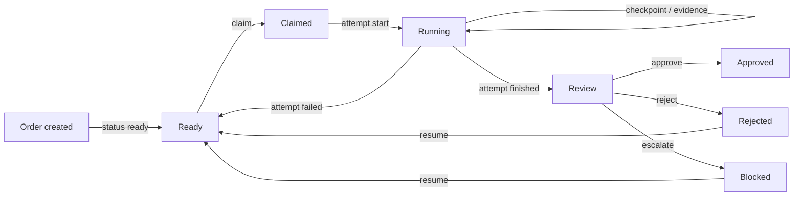
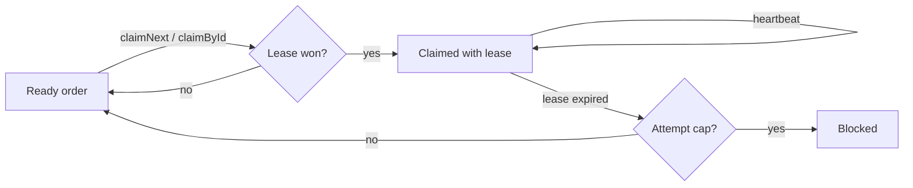
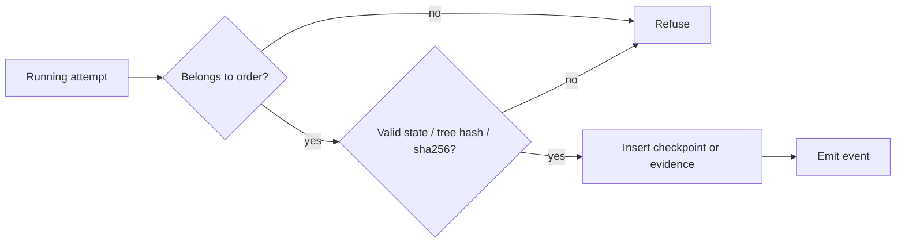
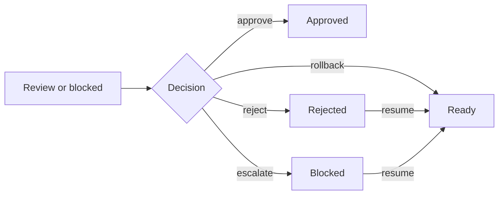

# Lifecycle

The state contracts enforced by the store. The store validates every transition
before it records the row and emits the event.

## Order lifecycle

An order moves from ready through a claim and a running attempt to review. The
verdict decides where it lands; resume returns rejected or blocked work to
ready.

## Claim and lease

An agent claims a ready order (`claim_next` or `claim` by id — atomic, the race
loser gets nothing), then keeps the lease alive with heartbeats. An expired
lease returns the order to the queue, or blocks at the attempt cap.

Defaults: lease `1800` s, attempt cap `3` (see
[configuration](configuration.md)).

## Checkpoint and evidence

The store validates the attempt and the handoff or proof before it records the
row and emits the event.

Evidence attach is an attempt-time action: it must land before
`attempt_finish`, because verdict approvals require at least one evidence row
and evidence cannot be added after the attempt closes.

## Verdict and resume

A verdict closes review or blocked work. Reject and escalate remain resumable;
rollback returns the order to ready directly.

Approve requires at least one evidence row on the attempt
(`brayer_verdict_issue` refuses otherwise).

## Identity refusal contract

Every mutating call carries a full `harness:agent:session` identity. The store
refuses the call — the order is untouched — when:

- the harness is missing, or the reserved name `any`
  ([`src/identity.js`](../src/identity.js));
- agent/session halves arrive in different channels (one via `_meta.brayer`,
  one via args) — *pairs never splice*;
- a forged or mismatched identity reaches a call gated by the adapter.

Refusal surfaces as a tool error and an audit trail keeps the order state
clean.
